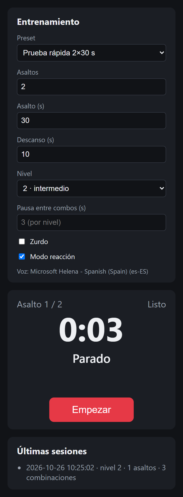
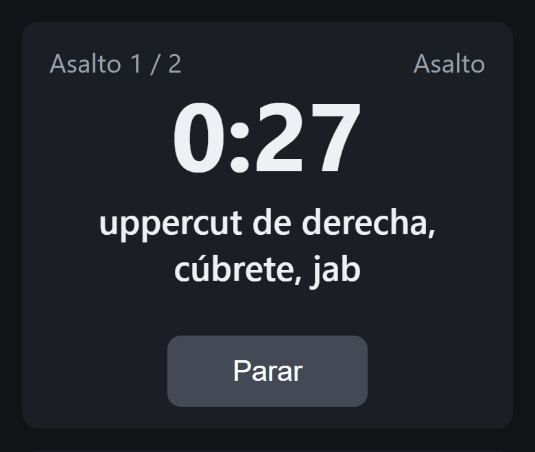
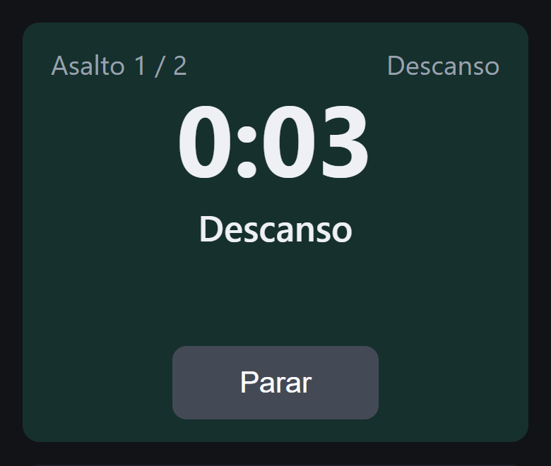
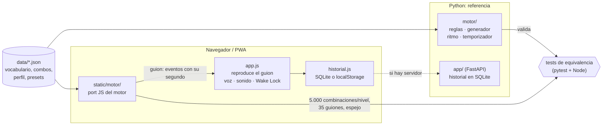

# Boxeo · entrenador por voz

[](https://github.com/david1cecilia-alt/boxeo-app/actions/workflows/pages.yml)

Temporizador de asaltos que **dicta combinaciones de boxeo en voz alta**, con defensas integradas,
para entrenar en el saco o la sombra sin mirar la pantalla. Funciona en el móvil **sin conexión**:
es una PWA instalable y todo se calcula en el dispositivo.

**▶ Pruébalo: <https://david1cecilia-alt.github.io/boxeo-app/>** (en el móvil: menú → *Instalar app*)

| Configuración | Combinación dictada | Modo reacción | Descanso |
|:---:|:---:|:---:|:---:|
|  |  |  |  |

## Qué hace

- **Asaltos configurables** (preset amateur 3×3 min con 1 min de descanso): campana al empezar y
  acabar, tablillas y aviso por voz a los 10 s del final.
- **Combinaciones con sentido técnico**, siempre por su nombre ("esquiva a la derecha, directo,
  gancho de izquierda"), nunca con números. Se generan por reglas y se mezclan con combos clásicos.
- **3 niveles**: longitud, golpes disponibles y pausa entre combinaciones cambian con el nivel.
- **Ritmo realista**: la siguiente combinación no llega hasta que da tiempo a ejecutar la anterior.
- **Modo reacción**: señales aleatorias ("¡esquiva!", "¡sal!") que nunca pisan una combinación.
- **Modo zurdo**: todo se define en guardia ortodoxa y el zurdo es su espejo exacto.
- **Perfil de entrenamiento**: pesos para insistir en lo que hay que mejorar (más
  bloquear-y-devolver, más finales en gancho…).
- **Sin conexión**: service worker con la app entera en caché, Wake Lock para que no se apague
  la pantalla e historial de sesiones en el propio móvil.

## Arquitectura



**El motor de Python es la referencia; el de JS es un port que tiene que demostrar que se comporta igual.**

- **`motor/` (Python)** es lógica pura y testeada: las reglas de boxeo viven aquí y las nuevas se
  escriben primero aquí. Ejemplo de regla, *cargar y soltar*: tras esquivar a la derecha el peso
  queda cargado a la derecha, así que el siguiente golpe se suelta con esa mano (directo o
  uppercut de derecha).
- **`static/motor/` (JS)** es un port fiel para que el móvil no necesite servidor. Lee **los mismos
  JSON**: el vocabulario no se duplica.
- **El guion es un dato**: el motor genera una lista de eventos con su segundo exacto
  (`combo`, `reaccion`, `aviso`, `descanso`…) y la interfaz solo la reproduce. La interfaz no
  sabe nada de boxeo, así que cambiarla (Tauri + React está en el horizonte) no toca las reglas.
- **Interfaces intercambiables**: la voz (`voz.js`, hoy Web Speech API, mañana Piper) y el
  historial (`historial.js`: SQLite si responde FastAPI, `localStorage` si no).

### Cómo se comprueba que los dos motores coinciden

Cada motor tiene su propio generador aleatorio (Mersenne Twister en Python, mulberry32 en JS),
así que **no** se exige la misma secuencia. Lo que se exige es lo que importa para el usuario.
`tests/js/exportar.mjs` genera datos con el motor JS y `tests/test_equivalencia_js.py` los
valida con el de Python:

| Qué se comprueba | Cómo |
|---|---|
| Ninguna combinación JS rompe una regla | 5.000 por nivel, ortodoxas y zurdas, pasan `reglas.validar()` de Python |
| Los guiones JS respetan los tiempos | 35 guiones (con y sin modo reacción, zurdo, pausas extremas) cumplen los mismos invariantes que los de Python: sin solapes, aviso a 10 s, duraciones, pausas y descansos |
| El perfil pesa igual | Frecuencia de finales en gancho, bloquear-y-devolver y entrada con jab: JS a ±5 puntos de Python (5.000 muestras; la diferencia real es < 2) |
| El espejo zurdo es idéntico | `espejo()` da exactamente lo mismo en los dos sobre todo el catálogo |
| JS es reproducible | Misma semilla ⇒ misma salida, byte a byte |

Los invariantes de guion se aplican también a los guiones de Python: así se comprueba que
describen de verdad al motor de referencia. Además, se probó a meter errores a propósito en el
port (pausa, margen, espejo, pesos, longitud, validación) y en cada caso falló al menos un test.

En CI los tests se ejecutan en cada push (**173 tests**), y solo si pasan se despliega en GitHub Pages.

## Probarlo en local

Requisitos: **Python 3.12** y **Node 18+** (solo para los tests de equivalencia).

```powershell
py -3.12 -m venv .venv
.venv\Scripts\python -m pip install -r requirements.txt

# App con servidor (historial en SQLite): http://127.0.0.1:8000
.venv\Scripts\python -m uvicorn app.main:crear_app --factory --reload

# Tests (sin Node, los de equivalencia se saltan)
.venv\Scripts\python -m pytest -q

# Web estática, igual que la publicada
.venv\Scripts\python herramientas\construir_sitio.py _site
.venv\Scripts\python -m http.server 8080 --directory _site
```

Los iconos se regeneran desde `static/iconos/guante.svg` con `herramientas\generar_iconos.py`
(usa Edge o Chrome headless).

## Estructura

| Carpeta | Qué contiene |
|---|---|
| `motor/` | Lógica pura en Python: acciones y espejo, reglas, generador, ritmo, temporizador |
| `static/motor/` | Port JS del motor |
| `static/` | Interfaz HTML + CSS + JS sin framework, service worker y manifest |
| `app/` | API FastAPI y acceso a SQLite |
| `data/` | Vocabulario, combos clásicos, perfil y presets (JSON): fuente única para los dos motores |
| `tests/` | pytest; `tests/js/` genera los datos de equivalencia con Node |
| `herramientas/` | Montar la web estática y generar iconos |
| `.github/workflows/` | Tests y despliegue en GitHub Pages |

## Límites conocidos

- Sin conexión, la voz depende de que el móvil tenga instalada una voz en español.
- Algunos detalles técnicos están marcados `REVISAR CON ENTRENADOR` en el código: son decisiones
  pendientes de validar con un entrenador, no inventadas.
- Siguiente paso: análisis de vídeo local con MediaPipe (por eso Python 3.12) y app de escritorio
  con Tauri + React.
