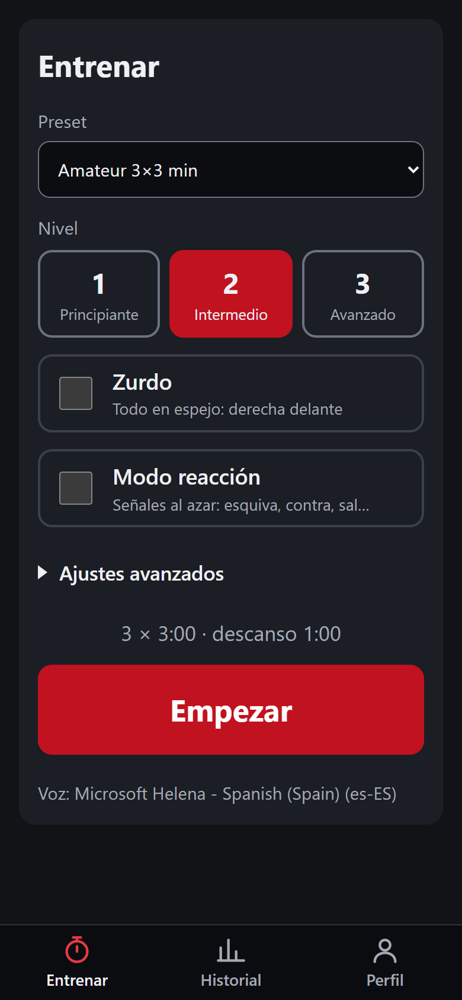
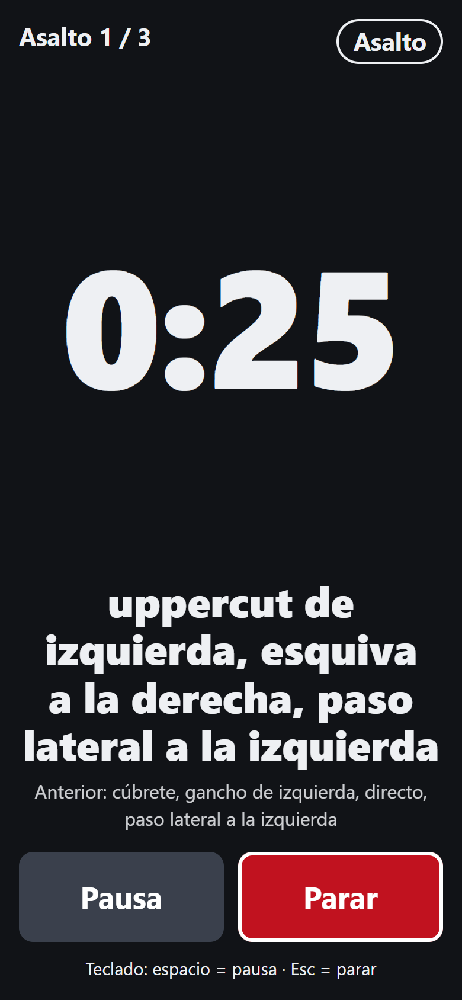
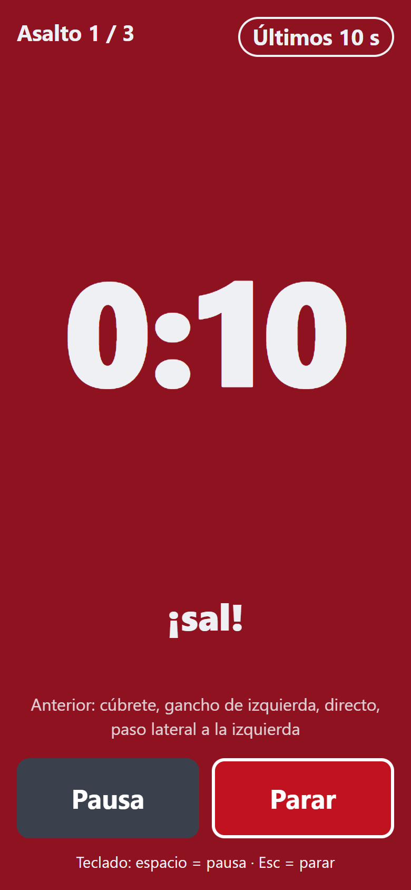
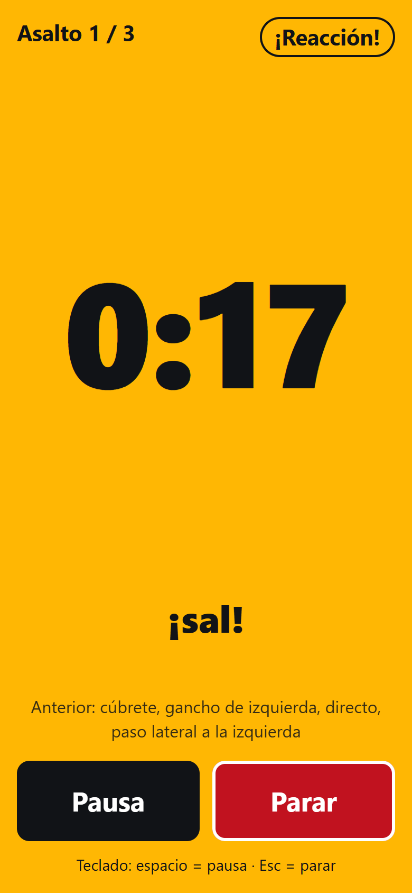
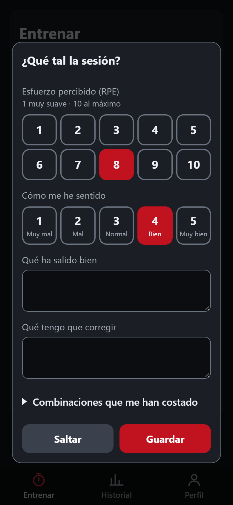
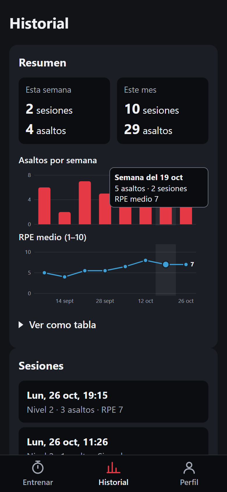
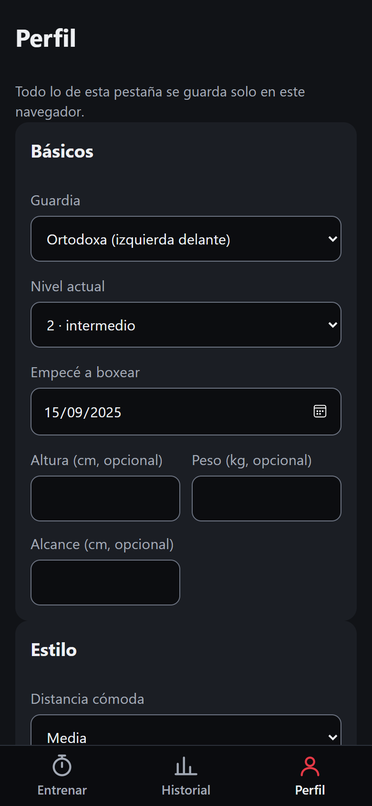
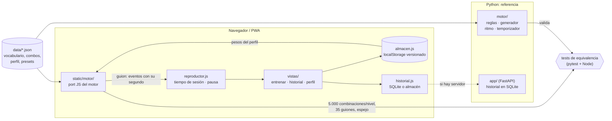

# Boxeo · entrenador por voz

[](https://github.com/david1cecilia-alt/boxeo-app/actions/workflows/pages.yml)

Temporizador de asaltos que **dicta combinaciones de boxeo en voz alta**, con defensas integradas,
para entrenar en el saco o la sombra sin mirar la pantalla. Funciona en el móvil **sin conexión**:
es una PWA instalable y todo se calcula en el dispositivo.

**▶ Pruébalo: <https://david1cecilia-alt.github.io/boxeo-app/>** (en el móvil: menú → *Instalar app*)

| Entrenar | Asalto en curso | Últimos 10 s | Modo reacción |
|:---:|:---:|:---:|:---:|
|  |  |  |  |

| Valoración | Historial | Perfil |
|:---:|:---:|:---:|
|  |  |  |

<sub>Capturas con datos de ejemplo.</sub>

## Qué hace

- **Tres pestañas** con barra inferior: *Entrenar*, *Historial* y *Perfil*. Rutas por hash
  (`#historial`), así que funcionan en GitHub Pages y sin conexión.
- **Pensada para usar con guantes a 1–2 m del móvil**: reloj enorme, combinación en grande,
  botones de 76 px y un color por fase (asalto, últimos 10 s, descanso, reacción, pausa).
  Durante la sesión solo se ve lo esencial.
- **Pausa y Reanudar** separados de **Parar**: la pausa congela el reloj, la voz y el guion, y
  reanuda en el mismo punto. La pantalla sigue encendida (Wake Lock).
- **Asaltos configurables** (preset amateur 3×3 min con 1 min de descanso): campana al empezar y
  acabar, tablillas y aviso por voz a los 10 s del final.
- **Combinaciones con sentido técnico**, siempre por su nombre ("esquiva a la derecha, directo,
  gancho de izquierda"), nunca con números. Se generan por reglas y se mezclan con combos clásicos.
- **3 niveles**: longitud, golpes disponibles y pausa entre combinaciones cambian con el nivel.
- **Ritmo realista**: la siguiente combinación no llega hasta que da tiempo a ejecutar la anterior.
- **Modo reacción**: señales aleatorias ("¡esquiva!", "¡sal!") que nunca pisan una combinación.
- **Modo zurdo**: todo se define en guardia ortodoxa y el zurdo es su espejo exacto.
- **Valoración tras cada sesión**: la app no puede saber si la técnica sale bien, así que la
  valoración es manual: esfuerzo percibido (RPE 1–10), cómo me he sentido, qué ha salido bien,
  qué corregir y qué combinaciones han costado. Se puede saltar y rellenar después.
- **Historial** con resumen semanal y mensual, dos gráficos SVG hechos a mano (asaltos por
  semana y RPE medio, con el mismo eje de semanas), detalle de cada sesión, notas editables y
  borrado.
- **Perfil**: guardia, nivel, estilo (cada pregunta admite «No lo sé»), focos de trabajo, notas del
  entrenador y los puntos marcados `REVISAR CON ENTRENADOR` en el motor para apuntar su respuesta.
  Los **pesos del generador** (más finales en gancho, más bloquear-y-devolver, más entradas con
  jab) se ajustan con deslizadores y sustituyen a los de `data/perfil.json`.
- **Sin conexión**: service worker con la app entera en caché.

## Tus datos

Perfil, notas y valoraciones se guardan **solo en el navegador** (`localStorage`); nunca van al
repositorio ni a `data/`. El almacén (`static/almacen.js`) tiene esquema versionado con
migraciones: las sesiones guardadas con versiones anteriores siguen apareciendo. Si el navegador
no deja guardar, la app sigue funcionando en memoria y avisa. Como `localStorage` se borra al
limpiar el navegador, el historial permite **exportar e importar** todo en un JSON. Con el servidor
local (FastAPI), las sesiones siguen en SQLite y la copia las incluye como referencia.

## Arquitectura



**El motor de Python es la referencia; el de JS es un port que tiene que demostrar que se comporta igual.**

- **`motor/` (Python)** es lógica pura y testeada: las reglas de boxeo viven aquí y las nuevas se
  escriben primero aquí. Ejemplo de regla, *cargar y soltar*: tras esquivar a la derecha el peso
  queda cargado a la derecha, así que el siguiente golpe se suelta con esa mano (directo o
  uppercut de derecha).
- **`static/motor/` (JS)** es un port fiel para que el móvil no necesite servidor. Lee **los mismos
  JSON**: el vocabulario no se duplica.
- **El guion es un dato**: el motor genera una lista de eventos con su segundo exacto
  (`combo`, `reaccion`, `aviso`, `descanso`…) y la interfaz solo la reproduce. La interfaz no
  sabe nada de boxeo, así que cambiarla (Tauri + React está en el horizonte) no toca las reglas.
- **Vistas, estado y motor separados**, sin frameworks: las vistas (`static/vistas/`) solo
  presentan; el estado del usuario vive en el almacén; `reproductor.js` lleva el tiempo de sesión
  (con pausa) sin saber nada de pantallas; `ajustes.js` une perfil y motor.
- **Interfaces intercambiables**: la voz (`voz.js`, hoy Web Speech API, mañana Piper) y el
  historial (`historial.js`: SQLite si responde FastAPI, el almacén si no).

### Cómo se comprueba que los dos motores coinciden

Cada motor tiene su propio generador aleatorio (Mersenne Twister en Python, mulberry32 en JS),
así que **no** se exige la misma secuencia. Lo que se exige es lo que importa para el usuario.
`tests/js/exportar.mjs` genera datos con el motor JS y `tests/test_equivalencia_js.py` los
valida con el de Python:

| Qué se comprueba | Cómo |
|---|---|
| Ninguna combinación JS rompe una regla | 5.000 por nivel, ortodoxas y zurdas, pasan `reglas.validar()` de Python |
| Los guiones JS respetan los tiempos | 35 guiones (con y sin modo reacción, zurdo, pausas extremas) cumplen los mismos invariantes que los de Python: sin solapes, aviso a 10 s, duraciones, pausas y descansos |
| El perfil pesa igual | Frecuencia de finales en gancho, bloquear-y-devolver y entrada con jab: JS a ±5 puntos de Python (5.000 muestras; la diferencia real es < 2) |
| El espejo zurdo es idéntico | `espejo()` da exactamente lo mismo en los dos sobre todo el catálogo |
| JS es reproducible | Misma semilla ⇒ misma salida, byte a byte |

Los invariantes de guion se aplican también a los guiones de Python: así se comprueba que
describen de verdad al motor de referencia. Además, se probó a meter errores a propósito en el
port (pausa, margen, espejo, pesos, longitud, validación) y en cada caso falló al menos un test.

### Tests de la interfaz y los datos

Tests unitarios de JS con `node:test` (`tests/js/*.test.mjs`), lanzados desde pytest para que un
solo comando lo cubra todo:

| Qué se comprueba | Cómo |
|---|---|
| Pausa y reanudación | Con un reloj falso y pausas en mitad de combos y descansos, cada evento del guion se lanza una sola vez, en orden y en su segundo de sesión |
| Los pesos del perfil llegan al generador | Subir cada peso aumenta la proporción de esas combinaciones en el guion; los pesos sustituyen a los de `perfil.json` |
| Migración del almacén | El historial anterior (v0) pasa a v1 conservando las sesiones; migrar dos veces no cambia nada; datos dañados o de una versión más nueva no se sobrescriben |
| Copia de seguridad | Exportar → JSON → importar da exactamente los mismos datos |
| Ids sin colisiones | Las sesiones locales usan UUID: borrar o importar no mezcla valoraciones |
| Contraste | Los colores de `estilos.css` cumplen AA (texto 4,5:1; bordes, foco y gráficos 3:1) |

En CI los tests se ejecutan en cada push (**183 tests**), y solo si pasan se despliega en GitHub Pages.

## Probarlo en local

Requisitos: **Python 3.12** y **Node 18+** (solo para los tests de JS y de equivalencia).

```powershell
py -3.12 -m venv .venv
.venv\Scripts\python -m pip install -r requirements.txt
.venv\Scripts\python -m playwright install chromium-headless-shell

# App con servidor (historial en SQLite): http://127.0.0.1:8000
.venv\Scripts\python -m uvicorn app.main:crear_app --factory --reload

# Tests (sin Node, los de JS y equivalencia se saltan; sin Playwright, los de las fotos del maniquí)
.venv\Scripts\python -m pytest -q

# Web estática, igual que la publicada (pinta también las fotos del maniquí sin WebGL)
.venv\Scripts\python herramientas\construir_sitio.py _site
.venv\Scripts\python -m http.server 8080 --directory _site
```

Los iconos se regeneran desde `static/iconos/guante.svg` con `herramientas\generar_iconos.py`
(usa Edge o Chrome headless).

El maniquí 3D (`static/maniqui/maniqui.glb`) se crea con Blender 4.5 LTS a partir del hombre
Superhero de Quaternius (Universal Base Characters, CC0), que no va en el repo, y el script reescribe
también el esqueleto de `data/posturas.json`:

```powershell
blender --background --factory-startup --python herramientas\blender\crear_maniqui_quaternius.py -- ruta\Superhero_Male_FullBody.gltf
```

Sin ruta usa la variable `MANIQUI_QUATERNIUS` o `Descargas\quaternius-superhero-male\`. El maniquí
anterior, de MPFB, sigue en `herramientas\blender\crear_maniqui.py`.

## Estructura

| Carpeta | Qué contiene |
|---|---|
| `motor/` | Lógica pura en Python: acciones y espejo, reglas, generador, ritmo, temporizador |
| `static/motor/` | Port JS del motor |
| `static/vistas/` | Las tres pestañas, el formulario post-sesión y el gráfico SVG |
| `static/` | Arranque, rutas, almacén, reproductor, voz, sonido, estilos, service worker y manifest |
| `app/` | API FastAPI y acceso a SQLite |
| `data/` | Vocabulario, combos clásicos, perfil por defecto, presets y puntos a revisar (JSON): fuente única para los dos motores |
| `tests/` | pytest; `tests/js/` tiene los tests de JS y genera los datos de equivalencia |
| `herramientas/` | Montar la web estática, generar iconos, extraer los puntos a revisar, ajustar y medir las posturas y crear el maniquí (`blender/`) |
| `.github/workflows/` | Tests y despliegue en GitHub Pages |

## Límites conocidos

- Sin conexión, la voz depende de que el móvil tenga instalada una voz en español.
- Algunos detalles técnicos están marcados `REVISAR CON ENTRENADOR` en el código: son decisiones
  pendientes de validar con un entrenador, no inventadas.
- Siguiente paso: análisis de vídeo local con MediaPipe (por eso Python 3.12) y app de escritorio
  con Tauri + React.
